# Real-Time 3D Mapping and Loop-Closure-Based SLAM for UAVs Using RGB-D Sensing

Low-cost indoor 3D mapping with an **Intel RealSense D455** RGB-D camera and a **Jetson Nano** (ROS 2 Foxy + RTAB-Map). The payload maps a lab onboard, using loop closure to limit drift, and the coloured map is viewed and measured on a laptop afterwards.

Author: Sreeyansh. School of Computer Science Engineering (AI and Robotics), VIT Chennai.

## The UAV
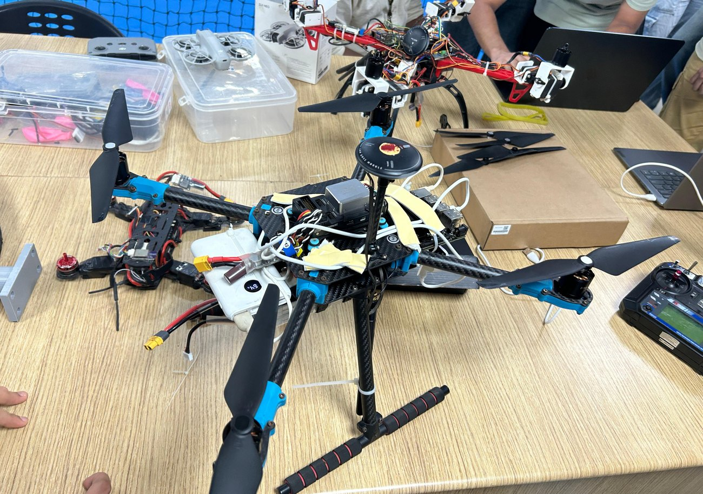

## The classroom that was mapped

| | | |
|---|---|---|
| 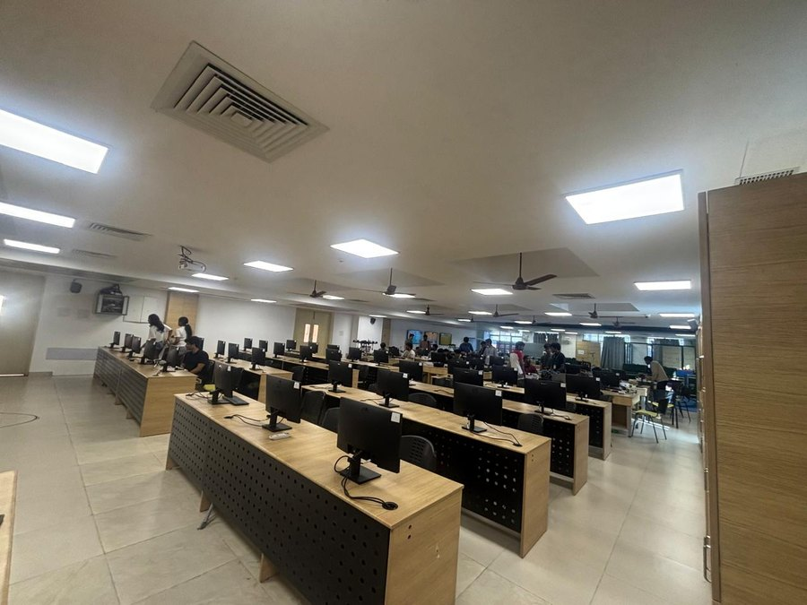 | 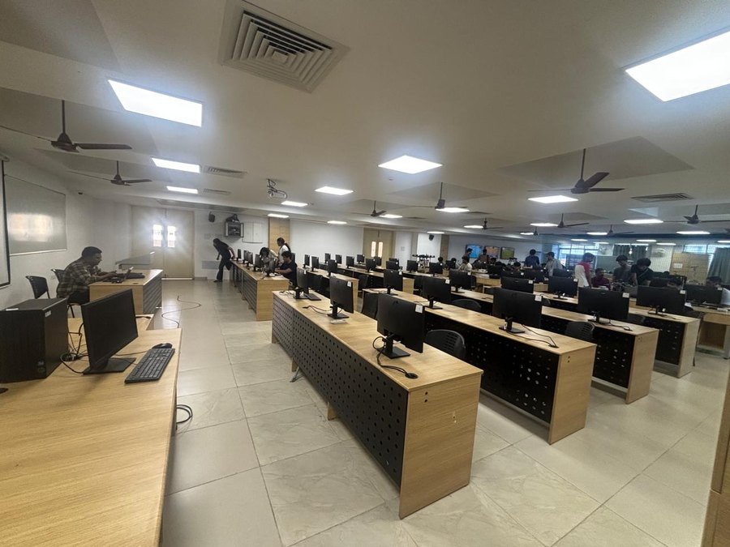 | 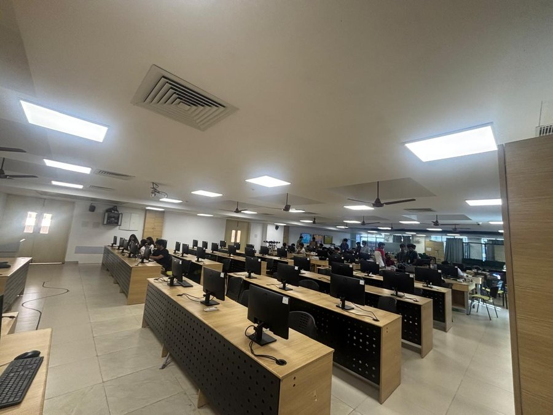 |

## Final 3D maps (coloured point clouds)
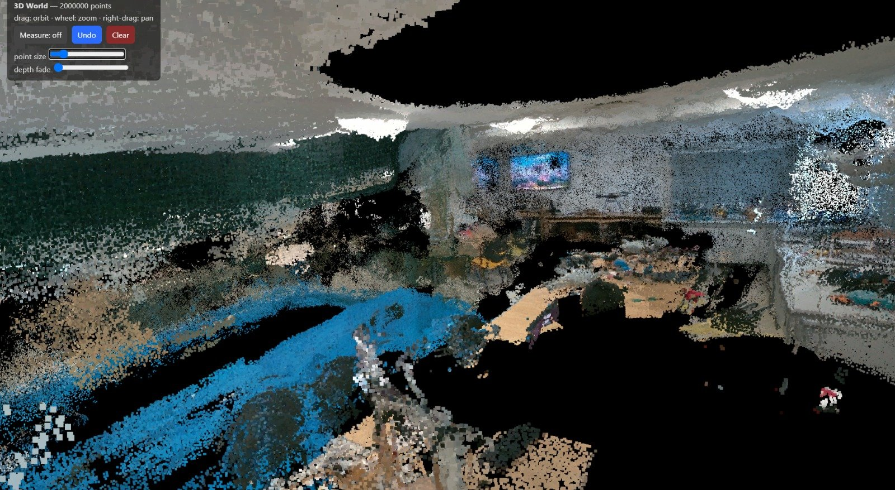
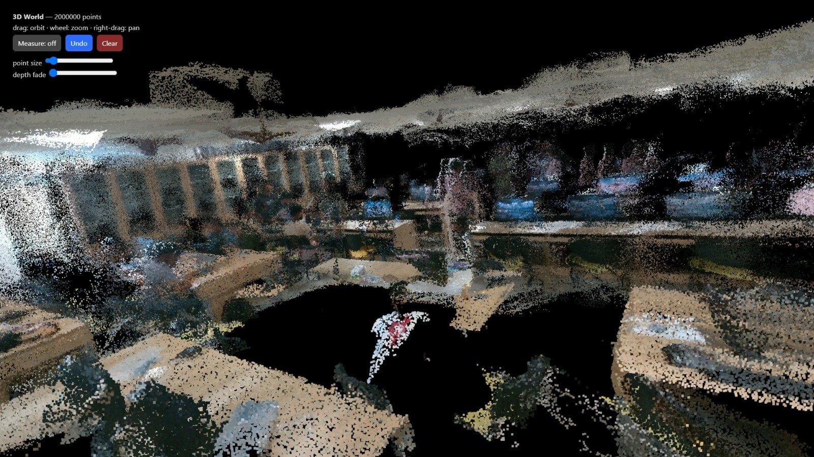
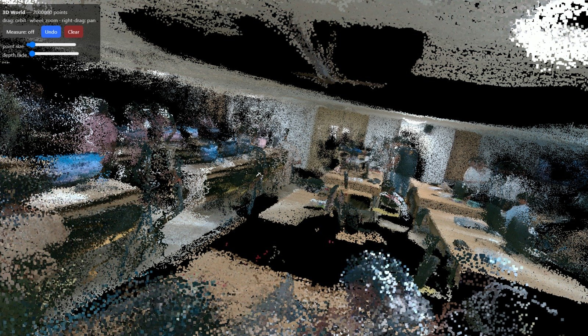
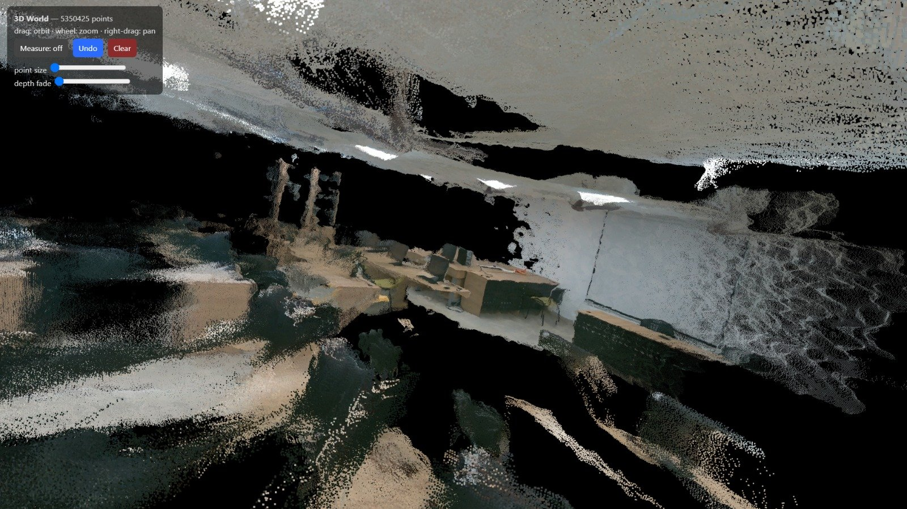
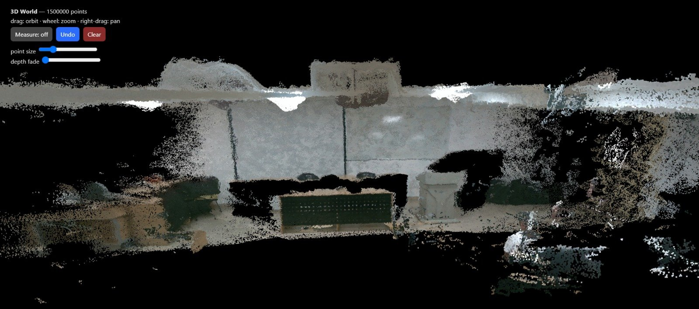
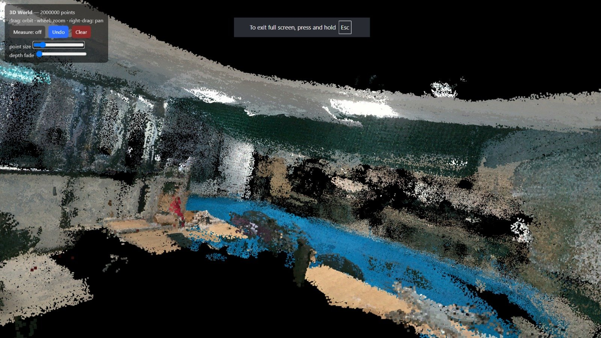

### Measuring in the viewer (56.2 cm desk edge)
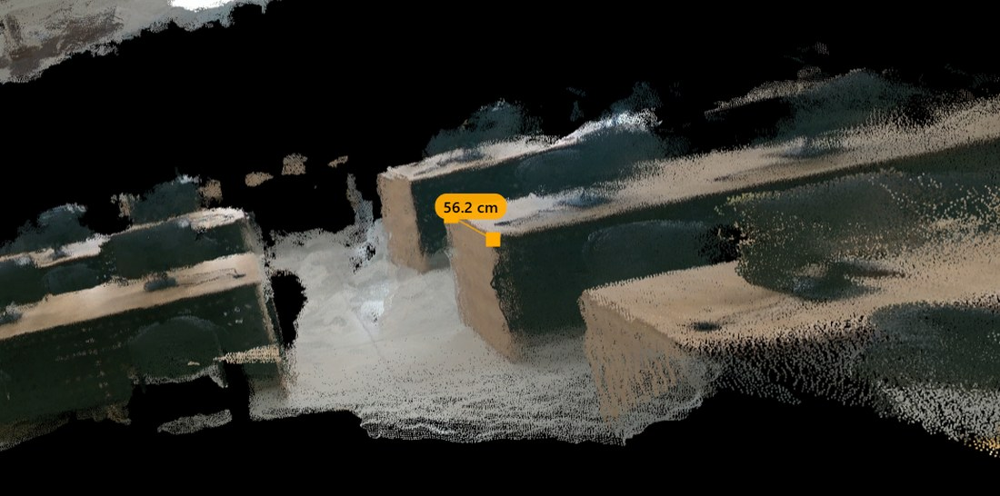

### Before and after fixing tracking
| Tracking lost (only the door mapped) | After: slower motion, camera angled down |
|---|---|
| 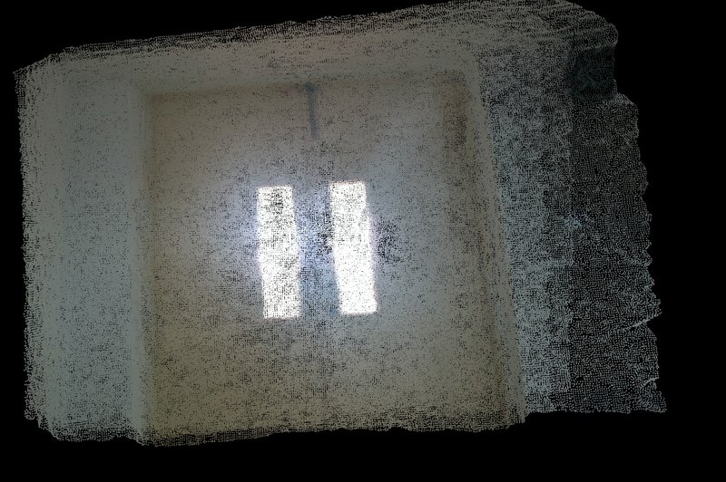 | 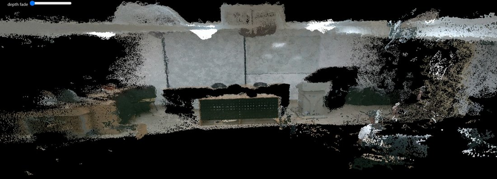 |

## Results
| Measure | Result |
|---|---|
| Frames per scan | 102-135 |
| Largest map | ~12 m x 16 m |
| Point cloud | 4-7 million coloured points |
| Loop closure | links recorded in every scan |

## How it works
1. **Jetson Nano:** `scripts/jetson_map.sh` (or `jetson_auto.sh <seconds> --force`) runs the D455 driver and RTAB-Map, saves the database, repairs a stray last frame (`fix_last_node.py`) and exports a coloured point cloud (9 m range).
2. **Laptop:** `scripts/build_world.ps1` fetches the newest map over SSH and builds an interactive viewer with orbit, zoom and click-to-measure (`make_bw_world.py`), a depth image (`make_depth_map.py`), and optionally a straightened solid mesh (`make_lab_model.py`, Open3D).

Constraint: the camera runs over USB 2.1, so capture is 640x480 at 10-15 fps.

## Repository layout
- `scripts/` Jetson and laptop scripts
- `docs/images/` README images
- Large data (maps, point clouds, databases, captured sessions) is git-ignored.

## Setup
Jetson: ROS 2 Foxy, `realsense2_camera`, `rtabmap_ros`. Laptop: Python with `numpy`, `opencv-python-headless`, `open3d`; PowerShell and OpenSSH. Edit the Jetson IP and key path in the `.ps1` scripts.
